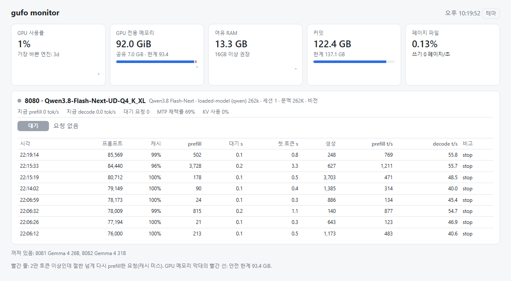

# Gufo: The ***Open Source*** Strix Halo AI engine 

<p align="center">
  
</p>

## gufo_win: upstream's Windows build with Gemma 4 and AtomicChat Flash-Next

This repository runs Gufo **natively on Windows 11** (no WSL) on AMD Strix Halo
(`gfx1151`). Since v0.24 upstream Gufo builds and serves on Windows itself
([#775](https://github.com/gufo-org/gufo/pull/775), see [BUILD-WINDOWS.md](BUILD-WINDOWS.md)),
so `main` here is upstream plus what upstream does not carry:

| Layer | Source | What it brings |
| --- | --- | --- |
| Engine and Windows build | [gufo-org/gufo](https://github.com/gufo-org/gufo) `main` | Gufo itself, the `windows-release` preset and its Windows platform code |
| Gemma 4 | [franzmoca/gufo](https://github.com/franzmoca/gufo) `feat/gemma` | Native Gemma 4 26B-A4B / 31B engine with MTP, vision and tool calls (described in the next section) |
| Fork-only fixes | this repository | See below |

The fork-only commits, cherry-picked on top of upstream:

- **Gemma 4 on Windows.** Windows maps registered host memory at a different
  device address, so the component cache's gather copies run only where the
  pointer is the device address; without that the first cache capture fails with
  "unspecified launch failure". Gemma's cache backing keeps 1 GiB segments
  (128 MiB segments failed 24K-token captures).
- **[AtomicChat abliterated](https://huggingface.co/AtomicChat/Qwen3.8-Flash-Next-Abliterated-Uncensored-GGUF)
  Flash-Next (`AD-4.85bpw-Q5_K_M`).** Upstream cannot load this mix: IQ4_XS/IQ4_NL/Q5_0
  experts, a Q4_1 n-gram table and Q8_0 HC inject weights. They are supported here,
  with the IQ4 experts on the routed F16 WMMA prefill and a fused IQ4_XS decode path.
- The per-request image budget is 256 MiB instead of 20 MiB (agents resend every image).
- `tools\windows\gufo_monitor.py` (a read-only web monitor) and `tools\windows\tdr_delay.bat`
  (GPU timeout).

Until October 27, 2026 this repository carried its own Windows port (a POSIX
compatibility layer from [pixmaate/gufo](https://github.com/pixmaate/gufo)); it was
retired once upstream built on Windows and is kept in history (tag `win-old-port-20261027`).
If Gemma 4 and the AtomicChat formats reach upstream, this repository can go too.

> [!WARNING]
> **Windows: raise the GPU timeout (TDR) before long runs.** Windows resets the GPU
> when submitted work takes longer than 2 seconds (`TdrDelay`). Under long prefills
> and agent sessions this shows up as `503 GPU context lost; restart required`
> (`device_lost`) and a "hardware problem" `LiveKernelEvent 141` in Windows, which is a
> timeout, not a hardware fault. Run `tools\windows\tdr_delay.bat set` (30 s, asks for
> administrator rights, then reboot; `restore` puts the old values back).
> Details: [docs/WINDOWS-TDR.md](docs/WINDOWS-TDR.md).

### Measured on Windows

One Strix Halo machine (Windows 11, 96 GB GPU carve-out), this build with TheRock
10.0.0, October 28, 2026 (Unsloth row: October 27). Server-reported rates, MTP with
each model's drafter, prompt cache defeated, one server at a time. A 40-identifier
verbatim copy test passed with no misses at temperature 0 and 0.7, at 400 and
103K–138K prompt tokens, on all three models.

| Model | Sessions x context | Prompt | Prefill (tok/s) | Decode, MTP (tok/s) |
| --- | --- | --- | ---: | ---: |
| Gemma 4 26B-A4B Q8_0 (MeroMero) | 1 x 262,144 | short, 512 generated | | 56.3 |
| | | 2.1K | 3,292 | 59.3 |
| | | 8.5K | 3,354 | 55.6 |
| | | 31.8K | 2,811 | 54.2 |
| Qwen3.8-Flash-Next AtomicChat `AD-4.85bpw-Q5_K_M` + vision | 2 x 262,144 | short, 512 generated | | 34.8 |
| | | 2.1K | 1,503 | 37.9 |
| | | 8.5K | 1,490 | 52.7 |
| | | 31.8K | 1,549 | 49.3 |
| Qwen3.8-Flash-Next Unsloth UD-Q4_K_XL + vision | 1 x 262,144 | short, 512 generated | | 34.6 |
| | | 2.1K | 1,466 | 39.4 |
| | | 8.5K | 1,417 | 40.5 |
| | | 31.8K | 1,494 | 37.6 |

- On the same machine a ROCm llama.cpp `llama-server` (b10967, flash attention, no
  speculative decoding) prefilled Gemma 4 26B Q8_0 at 1,624–1,735 / 602–608 / 959–965
  tok/s (2.1K / 8.5K / 31.8K, October 18) and the AtomicChat file at 1,041–1,218 tok/s.
- Decode with MTP varies with the draft acceptance (53–72% here).
- Against the October 27 build of this repository, upstream's October 27–28 changes
  (Flash-Next prefill stream overlap, #758) raised AtomicChat prefill ~5%, and Gemma 4
  measured 8–12% faster prefill on the same day. The previous Windows port (full host
  inlining; upstream's preset uses RelWithDebInfo `/O2 /Ob1`) measured 1,434–1,481 tok/s
  AtomicChat prefill, now exceeded.
- Flash-Next MTP uses Unsloth's `MTP/mtp-Qwen3.8-Flash-Next-shared-Q8_0.gguf`; Gufo
  rejects the `shared-Q4_K_M` drafter and the F16 vision projector (use `mmproj-BF16.gguf`).
- Gemma 4 12B loads but fails its first request (`split attention head grouping
  unsupported`); the Gemma 4 engine does not cover its head layout yet, on any OS.

### Memory setup on a 128 GB machine

- **GPU timeout (TDR): 30 s** with `tools\windows\tdr_delay.bat set`, then reboot.
- **GPU carve-out (Variable Graphics Memory): 96 GB, no more.** Windows then sees about
  32 GB of RAM, and its shared-GPU-memory limit is half of that, ~16 GB.
- **Stay inside the carve-out.** Past it the display driver moves buffers into system
  memory and Windows writes to the page file. Flash-Next UD-Q4_K_XL fits 1 session x
  262K + MTP + vision (~91 GB); the AtomicChat file is 3.75 GiB smaller and fits
  2 sessions x 262K (~92–95 GB). Check what other programs hold before loading.
- **Keep a large page file** (96 GB initial, 160 GB maximum here): Windows charges GPU
  allocations to the commit limit. It is reserved, not written.
- **Pass `--cache-ram-bytes`** (4 GiB for Flash-Next, 2 GiB per Gemma server); the
  automatic budget pins half of the free RAM.
- An `mmproj-BF16.gguf` beside the model (or in its parent folder) is loaded
  automatically. Keep it in a subfolder and pass `--mmproj` to choose vision.

### Build on Windows

Follow [BUILD-WINDOWS.md](BUILD-WINDOWS.md) with **TheRock 10.0.0**. Built the same
way, TheRock 10.2 produced correct output but decoded about 30x slower here
(Gemma 4 26B: 15 tok/s prefill, 2 tok/s decode), as upstream warns. Two things
this machine also needed:

- **CMake 4.3 or newer** (4.4.4 here): Visual Studio's CMake 3.31 fails to detect
  the HIP compiler through `clang-cl` ("MSVC compiler version not detected properly").
- **On a non-UTF-8 code page (Korean cp949 here)** vcpkg cannot extract the pkgconf
  and flac sources, whose tests contain emoji paths (`Invalid empty pathname`).
  Extracting those archives with Python instead works.

After building, copy TheRock's `.kpack` folder to `build\.kpack`: rocBLAS loads its
kernels from `..\.kpack` beside its DLL, and the preset does not stage it.

Serve a model with a fixed prompt-cache budget:

```powershell
build\windows-release\gufo.exe serve --host 127.0.0.1 --port 8093 llm `
  --model G4-26B-A4B-Q8_0.gguf --speculative mtp --mtp-model mtp-gemma-4-26B-A4B-it-Q8_0.gguf `
  --context 65536 --cache-ram-bytes 2147483648
```

To watch the servers, `python tools\windows\gufo_monitor.py --servers 8093 --logs <log folder>`
serves a page on http://127.0.0.1:8090: each session's phase (prefill progress or
decode rate), the last requests with cache misses marked, GPU use, GPU and system
memory, and page-file writes. It only reads, and shows a red banner while the
Windows GPU timeout is still 2 s.



### Troubleshooting

- **`413 payload_too_large` after reading a few images.** Request bodies are capped
  at 8 MiB by default, and agents such as pi resend every image of the conversation
  with each turn. Start the server with `--max-request-bytes 134217728` (128 MiB).
- **`503 device_lost` / "GPU context lost; restart required".** The Windows GPU timeout
  (TDR, 2 s by default) reset the driver during a long kernel. Raise it to 30 s and
  reboot: [docs/WINDOWS-TDR.md](docs/WINDOWS-TDR.md).
- **`logit distribution contains no finite values` followed by `routed F16 gate/up
  GEMM failed`.** Seen on a Beelink GTR9 Pro with BIOS GTRPR05 (AGESA 1.0.0.0c) right
  after RAM prompt-cache restores, once while another PyTorch ROCm program used the
  GPU. Upstream [#599](https://github.com/gufo-org/gufo/issues/599) reports the same
  pair on the same board and BIOS, fixed by the GTRPRPI1001C (AGESA 1.0.0.1c) update.
  Restarting the server clears it.

## About this fork: Gemma 4 on Gufo

This fork of [gufo-org/gufo](https://github.com/gufo-org/gufo) adds a native
**Gemma 4** engine to Gufo, with its own HIP kernels for prefill, decode and MTP
verification on Strix Halo. Gemma 4 isn't on upstream's roadmap, so it is
maintained here on the default branch, `feat/gemma`. Upstream
[PR #426](https://github.com/gufo-org/gufo/pull/426) stays open for feedback.

> [!NOTE]
> **What's new:** the [Gemma changelog](CHANGELOG_GEMMA.md) lists the fork's
> changes, newest first, with a link to each pull request.

### What it runs

- **Gemma 4 26B-A4B** (mixture of experts): Unsloth UD-Q4_K_XL, UD-Q6_K_XL,
  UD-Q8_K_XL and the QAT checkpoint.
- **Gemma 4 31B**: Unsloth UD-Q4_K_XL and UD-Q8_K_XL, and the 31B QAT (Q4_0).
- **Fine-tunes and uncensored versions** of both models: most quant shapes run,
  including llama.cpp's standard K-quant mixes (Q4_K_M, Q5_K_M, Q6_K), with the
  base model's MTP drafter. A GGUF that ships an older revision of the Gemma 4
  chat template loads with a warning and uses the built-in template. Fine-tunes
  are not qualified to the cards' limits; the 26B card records one fine-tune's
  results.

### Features

- MTP speculative decoding with the `gemma4-assistant` drafters, with a draft
  length learned from how many drafts are accepted.
- Image input through the Gemma 4 vision tower (`--mmproj`), with selectable
  image token budgets (`--image-tokens`).
- Gemma's reasoning channel and native tool-call syntax, with tool-call
  arguments streamed as they are generated.
- Gufo's serving features work with Gemma 4 too: every text endpoint, RAM and
  disk prompt caching, and batched concurrent sessions.

Benchmarks against llama.cpp and quality reports are in each model card:
[26B-A4B](docs/models/gemma-4-26b-a4b/README.md),
[31B](docs/models/gemma-4-31b/README.md) and
[31B QAT](docs/models/gemma-4-31b-qat/README.md).

### Status

The fork merges upstream `main` periodically and is currently synced with
v0.17.0. Like upstream, it is Strix Halo only (`gfx1151`, Linux).
Everything below the line is upstream's README; its build steps apply
unchanged ([Build from source](#build-from-source)). If a Gemma 4 GGUF doesn't
load, open an issue on this fork with the file name. Bug reports, benchmark
numbers from other setups, feature requests and PRs are welcome here.
Thanks to the Gufo maintainers for the engine this builds on.

---

## Upstream Gufo README

Gufo is a vertical local inference engine for Linux and Windows, specifically built and optimized for AMD Strix Halo hardware:
Ryzen AI MAX+ 395 systems with Radeon 8060S (`gfx1151`), up to 128 GiB of unified memory.

**Contributions are welcome!**

See the [changelog](CHANGELOG.md) and [GitHub Releases](https://github.com/gufo-org/gufo/releases)
for user-facing changes and release history.

> [!TIP]
> Check out **[Gufo RDMA for Dual Strix Halo](https://github.com/neuhaus/gufo)**, a Gufo variant that has not been merged yet!

## Models and benchmarks

All model documentation lives under [docs/models](docs/models/README.md):

| Model | Inference modes | Hugging Face weights | Benchmarks | Quality |
| --- | --- | --- | --- | --- |
| [Qwen3.8 27B](docs/models/qwen3.8-27b/README.md) | Q4/Q8, images, AR, DFlash2 | Unsloth [Q4_K_XL](https://huggingface.co/unsloth/Qwen3.8-27B-GGUF/blob/4ca720788d1e01f1bff70c033e0d0028fd02e502/Qwen3.8-27B-UD-Q4_K_XL.gguf) / [Q8_K_XL](https://huggingface.co/unsloth/Qwen3.8-27B-GGUF/blob/4ca720788d1e01f1bff70c033e0d0028fd02e502/Qwen3.8-27B-UD-Q8_K_XL.gguf) · [DFlash2 Q4_K_M](https://huggingface.co/z-lab/Qwen3.8-27B-DFlash2-GGUF/blob/2d9571f8ce46e151f61c6499c99dee6079e1d610/Qwen3.8-27B-DFlash2-Q4_K_M.gguf) | Q4: **648.89 tok/s pp**; up to **71.55 tok/s tg** single user and **128.42 aggregated tok/s** on 8 concurrent requests with DFlash2 · [Benchmarks](docs/models/qwen3.8-27b/BENCHMARKS.md) | [Quality](docs/models/qwen3.8-27b/QUALITY.md) |
| [Qwen3.8 Flash-Next](docs/models/qwen3.8-flash-next/README.md) | Q4, images, AR, MTP | Unsloth [Q4_K_XL](https://huggingface.co/unsloth/Qwen3.8-Flash-Next-GGUF/tree/38bb39ee97821de2c9009abb7e93950eec396e66/UD-Q4_K_XL) · [MTP Q8_0](https://huggingface.co/unsloth/Qwen3.8-Flash-Next-GGUF/blob/38bb39ee97821de2c9009abb7e93950eec396e66/MTP/mtp-Qwen3.8-Flash-Next-shared-Q8_0.gguf) | **1,801.01 tok/s pp** (AR); up to **116.93 tok/s tg** single user and **245.81 aggregated tok/s** on 8 concurrent requests with MTP · [Benchmarks](docs/models/qwen3.8-flash-next/BENCHMARKS.md) | [Quality](docs/models/qwen3.8-flash-next/QUALITY.md) |
| [DeepSeek V4 Flash](docs/models/deepseek-v4-flash/README.md) | AR, DSpark | [antirez Flash 0731 IQ2XXS](https://huggingface.co/antirez/deepseek-v4-gguf/blob/1cd7b564460821938add0475a60b942c409295e0/DeepSeek-V4-Flash-IQ2XXS-w2Q2K-AProjQ8-SExpQ8-OutQ8-chat-v2-imatrix-0731.gguf) · [DSpark](https://huggingface.co/antirez/deepseek-v4-gguf/blob/e7f04037032990db0346398d249baf9fb9df1ccc/DeepSeek-V4-Flash-DSpark-support-0731.gguf) | **484.62 tok/s pp**; up to **26.62 tok/s tg** single user and **54.74 aggregated tok/s** on 8 concurrent requests with DSpark · [Benchmarks](docs/models/deepseek-v4-flash/BENCHMARKS.md) | [Quality](docs/models/deepseek-v4-flash/QUALITY.md) |
| [Qwen3-ASR 1.7B](docs/models/qwen3-asr/README.md) | Speech recognition | [BF16](https://huggingface.co/Qwen/Qwen3-ASR-1.7B/tree/7278e1e70fe206f11671096ffdd38061171dd6e5) | **15.27× realtime** · [Benchmarks](docs/models/qwen3-asr/BENCHMARKS.md) | [Quality](docs/models/qwen3-asr/QUALITY.md) |
| [EmbeddingGemma 2](docs/models/embeddinggemma-2/README.md) | Text and image embeddings | [BF16](https://huggingface.co/google/embeddinggemma-2/tree/914f7f89142e33e77833254d9c9b90c3cef7303b) | Up to **41.5k tokens/s** over HTTP; **13.0 ms** for a 404-token request · [Benchmarks](docs/models/embeddinggemma-2/BENCHMARKS.md) | [Quality](docs/models/embeddinggemma-2/QUALITY.md) |
| [Qwen3-TTS 1.7B](docs/models/qwen3-tts/README.md) | Speech synthesis and voice cloning | BF16 [CustomVoice](https://huggingface.co/Qwen/Qwen3-TTS-12Hz-1.7B-CustomVoice) / [VoiceDesign](https://huggingface.co/Qwen/Qwen3-TTS-12Hz-1.7B-VoiceDesign) / [Base](https://huggingface.co/Qwen/Qwen3-TTS-12Hz-1.7B-Base) | Up to **2.54× realtime**; **201 ms** to first audio (CustomVoice) · [Benchmarks](docs/models/qwen3-tts/BENCHMARKS.md) | [Quality](docs/models/qwen3-tts/QUALITY.md) |
| [Qwen-Image-2.1](docs/models/qwen-image-2.1/README.md) | BF16 image generation and editing | [Complete pipeline](https://huggingface.co/Qwen/Qwen-Image-2.1/tree/b3179ad355be050328e483a9dfdd9e60cd62adfa) | In progress · [Benchmarks](docs/models/qwen-image-2.1/BENCHMARKS.md) | [Quality](docs/models/qwen-image-2.1/QUALITY.md) |
| [MiniMax H3](docs/models/minimax-h3/README.md) | BF16 text to video/audio | [FL2VA pipeline](https://huggingface.co/MiniMaxAI/MiniMax-H3/tree/42ed227ee7df40d41602854ae760620d6eb651fe/FL2VA) | In progress · [Benchmarks](docs/models/minimax-h3/BENCHMARKS.md) | [Quality](docs/models/minimax-h3/QUALITY.md) |

Peak measured workloads; text pp is autoregressive (AR), while tg uses the
named speculative mode. Peaks include repetitive output; aggregate tg sums
individual request decode rates. Qwen27B's single-user peak uses the short-prompt
C1 workload. Audio excludes loading.
Each model guide lists the required files and complete benchmark settings.

## Philosophy

- Contributions are welcome! We need the help of Strix Halo community to keep improving gufo!
- We would like this to be the one-stop shop for Strix Halo Local AI enthusiasts: batteries included for text, audio, image, and video models.
- Build and optimize specifically for the Strix Halo 128 GiB hardware. Smaller memory configurations should still work and preserve the speed benefits for models that can fit on memory.
- Support only the best available models for their size that can run on this hardware: less code to maintain, more focused optimization and testing work.
- Preserve quality when optimizing. Each model's quality report records independent numerical checks, execution consistency and unresolved gaps. Don't reuse kernels across different models to limit blast radius of a code change.
- Treat concurrent requests, cancellation and conversation caching as first-class workloads.
- Keep production dependencies small and development tools separate.

## Quickstart

```sh
hf download unsloth/Qwen3.8-27B-GGUF \
  Qwen3.8-27B-UD-Q8_K_XL.gguf \
  --revision 4ca720788d1e01f1bff70c033e0d0028fd02e502 \
  --repo-type model \
  --local-dir models/Qwen3.8-27B-GGUF
hf download z-lab/Qwen3.8-27B-DFlash2-GGUF \
  Qwen3.8-27B-DFlash2-Q4_K_M.gguf \
  --revision 2d9571f8ce46e151f61c6499c99dee6079e1d610 \
  --repo-type model \
  --local-dir models/Qwen3.8-27B-DFlash2-GGUF
podman pull ghcr.io/gufo-org/toolboxes/gufo-runtime:latest
podman run --rm \
  --userns=keep-id:uid=1000,gid=1000 \
  --device /dev/kfd \
  --device /dev/dri \
  --group-add keep-groups \
  --ulimit memlock=-1 \
  -p 8080:8080 \
  -v ./models:/models:ro \
  ghcr.io/gufo-org/toolboxes/gufo-runtime:latest \
  gufo serve --host 0.0.0.0 --port 8080 llm \
  --model /models/Qwen3.8-27B-GGUF/Qwen3.8-27B-UD-Q8_K_XL.gguf \
  --speculative dflash2 \
  --dflash-model /models/Qwen3.8-27B-DFlash2-GGUF/Qwen3.8-27B-DFlash2-Q4_K_M.gguf
```

Rootless Podman needs `crun` for `--group-add keep-groups`. Your host user must
have read/write access to `/dev/kfd` and `/dev/dri/renderD*`, usually through the
`render` and `video` groups; log out and back in after changing membership.
Container groups named `video`/`render` do not preserve host supplementary
groups. Check `id`, `ls -l /dev/kfd /dev/dri/renderD*`, and
`podman info --format '{{.Host.OCIRuntime.Name}}'` if ROCm reports no device.
See [Podman's rootless group-access guidance](https://github.com/containers/podman/blob/main/troubleshooting.md#20-passed-in-devices-or-files-cant-be-accessed-in-rootless-container).

On Fedora or another SELinux-enforcing host, GPU enumeration can succeed while
SELinux blocks mapping `/dev/kfd`, causing ROCr to report a misleading
“Memory critical” error. Check the **host** audit log:

```sh
sudo ausearch -m avc -ts recent | grep -E '/dev/kfd|hsa_device_t'
```

If it shows a denied `map` for the container, Podman documents this fix:

```sh
sudo setsebool -P container_use_devices true
```

This persistently allows containers to access device labels for devices passed
into them; it affects all containers on that host. Review that policy scope
before enabling it. See [Podman's device documentation](https://docs.podman.io/en/latest/markdown/podman-run.1.html#device-host-device-container-device-permissions)
and the [SELinux container policy](https://github.com/containers/container-selinux/blob/main/container.te).

Then, from another terminal, ask it something through the OpenAI-compatible API:

```sh
curl http://localhost:8080/v1/chat/completions \
  -H "Content-Type: application/json" \
  -d '{
    "model": "Qwen3.8-27B-UD-Q8_K_XL",
    "messages": [{"role": "user", "content": "Say something"}]
  }'
```

For Open WebUI, VS Code, OpenAI SDK and Responses-API clients (for example
Codex), set the API base URL to `http://localhost:8080/v1`. Chat Completions and
Responses support text, images, function tools, structured output and streaming.
See the [API contract](docs/SERVER.md).

The text server uses the model's native context by default and generates until
EOS or the context is full. `--context N` sets context capacity per session;
`--max-tokens N` sets a default response limit that clients can override.
Reasoning tokens count toward that response limit.

## Harness notes

- **Qwen with Codex:** Codex sends developer messages mid-conversation, after
  compaction or a settings change. Qwen's template accepts only one leading
  system turn, so Gufo moves them there. The request that introduces one is
  prefilled again; later requests reuse the cache. See the
  [API contract](docs/SERVER.md).
- **Qwen with Claude Code:** not supported. Claude Code adds a system message
  to `messages` on every turn, so Gufo moves a new one to the leading system
  turn each time and every request prefills the whole history again (#522).

## Build from source

Production packages target Linux x86-64 on AMD Strix Halo (`gfx1151`).
Windows x86-64 is a supported native build target for development; see
[BUILD-WINDOWS.md](BUILD-WINDOWS.md). CMake owns
one production configuration for both Nix and ordinary Linux builds. Tests,
profilers, tuning executables and Python reference runners are not installed
with the production package. No `build.sh` wrapper is needed.

### With Nix

```sh
nix build
./result/bin/gufo diagnose
./result/bin/gufo serve llm --model /path/to/model.gguf
```

[flake.lock](flake.lock) pins the dependencies. `nix develop` adds profiling,
model-download and independent evaluation tools; these are not runtime
requirements. Optional benchmark baselines are selected separately with
`nix shell .#ds4-reference`, `.#llama-cpp-reference` or
`.#llama-cpp-mtp-reference`; see [benchmarking](docs/BENCHMARKS.md).
See [testing](docs/TESTING.md) for the small hosted CI suite and
explicit local quality checks.

Prebuilt store paths are published to the `gufo` Cachix cache. The flake
declares it in `nixConfig`: users listed in `trusted-users` are asked to accept
it, or pass `--accept-flake-config`. Nix ignores it for other users; add it
system-wide with `cachix use gufo` or in `/etc/nix/nix.conf`:

```
extra-substituters = https://gufo.cachix.org
extra-trusted-public-keys = gufo.cachix.org-1:rfZe3n4lHINgyoACKzs5EthIZmBNvEyCCtufUpth0PE=
```

The Nix package and development shell use ROCm 10.1.0 (HIP Clang 24)
from the pinned [nixpkgs ROCm 10.1 update](https://github.com/NixOS/nixpkgs/pull/573885).
Python, Python packages and general build dependencies come from the pinned
`nixos-unstable` input. The ROCm package set comes from the separate fork,
retaining its compiler/runtime dependencies to reuse the gfx1151 binaries on
`gufo.cachix.org`. All Nix workflows configure this cache explicitly.
Both include a [queue-memory patch](.devops/nix/patches/rocr-fixed-cwsr-rocm10.patch)
for Strix Halo. It keeps queue save/restore buffers, launch/copy arenas and
code-loading staging resident during host memory compaction, while retaining
managed-memory support and the ordinary fine-grained host-allocation policy.

### Without Nix

Install a C++20 compiler, CMake 3.21+, Ninja, pkg-config and the
following development libraries. The pinned Nix toolchain uses GCC
16.2 and ROCm 10.1.0 (HIP Clang 24). Attention and audio convolution kernels are compiled
directly from HIP. Python, Triton/AOTriton, Composable Kernel and MIOpen are
not production build or runtime requirements.
For the same protection against queue evictions as the Nix build, apply the
ROCr patch above when building your runtime. Flash-Next's host buffers also use
Linux long-term pins, with ordinary HIP registration retained when system
limits disallow those pins. Gufo leaves `HSA_USERPTR_FOR_PAGED_MEM` unchanged.

| Dependency | Used for |
| --- | --- |
| ROCm HIP compiler/runtime, hipBLAS, hipBLASLt, rocBLAS | GPU execution and matrix multiplication |
| hipCUB, rocPRIM, rocWMMA headers | Compiled GPU kernels |
| ICU, libcurl, OpenSSL, libpng, libjpeg, libwebp | Tokenization, HTTPS, hashing and images |
| libsndfile, libsoxr | Audio decoding and reference-compatible resampling |
| FFmpeg and ffprobe | Video/audio output; invoked as separate executables |

Install ROCm using [AMD's Linux instructions](https://rocm.docs.amd.com/projects/install-on-linux/en/latest/).
Use the development packages for the libraries above. ROCm normally installs
under `/opt/rocm`.

For example, on Debian/Ubuntu the ordinary system libraries are:

```sh
sudo apt install build-essential cmake ninja-build pkg-config \
  libicu-dev libcurl4-openssl-dev libssl-dev libpng-dev libjpeg-dev libwebp-dev libsndfile1-dev libsoxr-dev ffmpeg

# ROCm libraries from the table, named as AMD's repository ships them.
sudo apt install hipblas-dev hipblaslt-dev rocblas-dev \
  hipcub-dev rocprim-dev rocwmma-dev

cmake --preset release -DCMAKE_INSTALL_PREFIX="$HOME/.local"
cmake --build --preset release --parallel 4
./build/release/gufo diagnose
./build/release/gufo serve llm --model /path/to/model.gguf
```

Configuring fails at `find_package(hipblas)` when those ROCm packages are
missing. Other distributions name them `-devel` instead of `-dev`.
For nonstandard installations, pass ordinary CMake paths, for example
`cmake --preset release -DCMAKE_PREFIX_PATH="/opt/rocm"`.
If compiler discovery picks a system Clang, also pass
`-DCMAKE_HIP_COMPILER=/opt/rocm/llvm/bin/clang++`.
Use `cmake --install build/release` to install Gufo,
its runtime data and license notices. The GPU driver must allow your user to
access `/dev/kfd` and `/dev/dri`; model weights are acquired separately.

The same source, compiler flags and install rules serve both builds. Nix pins
the complete toolchain for reproducible comparisons; changing the compiler or
math libraries requires the affected model's quality checks.

## License

Gufo's original code is [MIT licensed](LICENSE). Adapted code and dependencies
retain their own notices in [NOTICE](NOTICE), [THIRD_PARTY_NOTICES.md](THIRD_PARTY_NOTICES.md)
and `licenses/`, installed under `share/licenses/gufo`. Model weights are not
bundled and retain their publishers' terms.

## Reference Projects

The initial design is informed by the following open source projects:

- [llama.cpp](https://github.com/ggml-org/llama.cpp) for compact model serving, GGUF, and CPU/GPU correctness paths.
- [LaurentZuijdwijk/llama.cpp](https://github.com/LaurentZuijdwijk/llama.cpp), [Nathanw1014/strix-halo-llamacpp](https://github.com/Nathanw1014/strix-halo-llamacpp), and [gaetan-puleo/llama-cpp-strix-halo](https://github.com/gaetan-puleo/llama-cpp-strix-halo) for Strix Halo optimization inspiration.
- [vLLM](https://github.com/vllm-project/vllm) for continuous batching and paged request scheduling.
- [hipEngine](https://github.com/shisa-ai/hipEngine) for torch-free HIP execution, and native speculative-cycle work.
- [ds4](https://github.com/antirez/ds4) for DeepSeek V4 Flash, MoE scheduling, and DSpark.
- [audio.cpp](https://github.com/0xShug0/audio.cpp) for audio models for tts and asr tasks.
