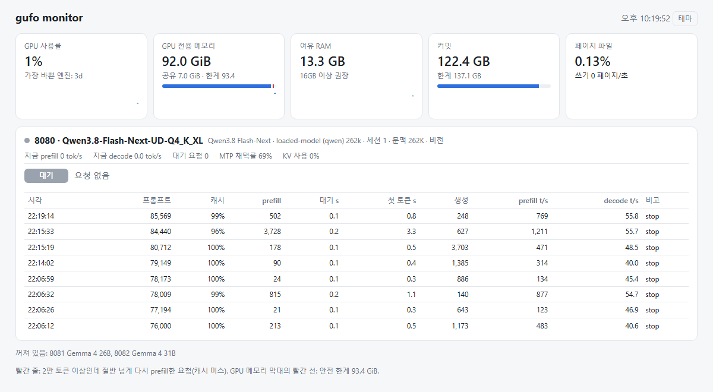

# Gufo: The ***Open Source*** Strix Halo AI engine

<p align="center">
  
</p>


## gufo_win: upstream's Windows build with the Gemma 4 extension

This repository runs Gufo **natively on Windows 11** (no WSL) on AMD Strix Halo
(`gfx1151`). Upstream Gufo builds and serves on Windows itself since v0.24
([#775](https://github.com/gufo-org/gufo/pull/775), see [BUILD-WINDOWS.md](BUILD-WINDOWS.md)),
so `main` here is an upstream release plus what upstream does not carry:

| Layer | Source | What it brings |
| --- | --- | --- |
| Engine and Windows build | [gufo-org/gufo](https://github.com/gufo-org/gufo) `main` (v0.35.0 + 2, November 17, 2026) | Gufo itself, the `windows-release` preset and its Windows platform code; since #1046/#1047 also every hook the Gemma 4 extension needs |
| Gemma 4 engine | [franzmoca/gemma4-gufo-extension](https://github.com/franzmoca/gemma4-gufo-extension) with Windows fixes: branch [`gemma4-ext`](https://github.com/akamotaco/gufo_win/tree/gemma4-ext) of this repository, built with `-DGUFO_EXTENSION_DIRS` | Gemma 4 26B-A4B / 31B with MTP, vision and tool calls |
| Fork-only fixes | this repository | See below |

Fork-only changes:

- **Gemma 4 on Windows.** Cache backing segments are 1 GiB on Windows: with
  128 MiB segments, Gemma 4 captures past ~24K tokens failed their device-to-host
  copies (`hipErrorInvalidValue`, unchecked, so a later kernel launch reported
  "invalid argument" and the request failed).
- **Gemma 4 extension on Windows** (branch `gemma4-ext`: franzmoca's extension `main`
  plus these changes, MIT like the original):
  - `extension.json` lists `windows` among its platforms; without it the build skips
    the extension on Windows.
  - The cache's gather copies use a pointer only where it is also the device address.
    Windows maps registered host memory at a different device address, so a gather
    kernel given the host pointer fails the first cache capture with
    "unspecified launch failure".
  - A failed cache copy clears the HIP error and logs `[gemma4] event=cache_copy_failed`
    with both pointers' attributes. Before, the stale error failed the next decode
    (`candidates.hip.cpp ... invalid argument`) instead of costing only a cache miss.
  - The vision encoder uploads its padded MLP weights with a 1D copy from a host
    buffer. The 2D copy from the mapped GGUF failed inside the Windows driver
    ("Failed PAL memory allocation", 27 times at every load) while reporting
    success, so Gemma 4 described images that were not there.
- The per-request image budget is 256 MiB instead of 20 MiB (agents resend every image).
- `tools\windows\gufo_monitor.py` (a read-only web monitor) and `tools\windows\tdr_delay.bat`
  (GPU timeout).
- Upstream's GitHub workflows are renamed to `.yml.bak`.

Until v0.30 this repository merged the Gemma engine from franzmoca's `feat/gemma`
branch and also served the AtomicChat Flash-Next mix (IQ4_XS/IQ4_NL/Q5_0 experts).
Both are kept in history; the AtomicChat formats were not carried to v0.30's
extension layout. The original Windows port (until October 27, 2026) is tag
`win-old-port-20261027`.

> [!WARNING]
> **Windows: raise the GPU timeout (TDR) before long runs.** Windows resets the GPU
> when submitted work takes longer than 2 seconds (`TdrDelay`). Under long prefills
> and agent sessions this shows up as `503 GPU context lost; restart required`
> (`device_lost`) and a "hardware problem" `LiveKernelEvent 141` in Windows, which is a
> timeout, not a hardware fault. Run `tools\windows\tdr_delay.bat set` (30 s, asks for
> administrator rights, then reboot; `restore` puts the old values back).
> Details: [docs/WINDOWS-TDR.md](docs/WINDOWS-TDR.md).

### Measured on Windows

One Strix Halo machine (Windows 11, 96 GB GPU carve-out), this build with TheRock
10.0.0, November 5, 2026. Server-reported rates, MTP with each model's drafter,
prompt cache defeated, one server at a time. A 40-identifier verbatim copy test
passed with no misses at temperature 0 and 0.7, at about 400 and 75K prompt tokens.
Gemma 4 26B greedy outputs on 8 fixed prompts match the earlier `feat/gemma` build
token for token.

Re-checked on v0.31.0 (November 6, 2026): Gemma 4 26B and 31B greedy outputs still
match `feat/gemma` on all 8 prompts, the copy test passes at 75K tokens on both,
tool calls (buffered and streamed), a 6-turn agent chat and image reading (shapes,
colors and text of a test image) work, and Gemma 4 26B
speeds are within 4% of the table below.

Re-checked on upstream `main` of November 7 (November 8): the same checks pass on
Gemma 4 26B and 31B (8/8 identical, copy test, tool calls, agent chat, images), and
Qwen3.8-Flash-Next Orca Q4Mix (1 session) passes the copy test, tool calls, agent chat
and images at 1,554-1,595 tok/s prefill and 38.4-41.7 tok/s decode with the fork's
then serial shared expert (upstream #1048 had made Windows decode 13-15% slower; since
#1107 upstream measures both layouts at load and keeps the faster one, so the fork
no longer carries that change).

Re-checked on v0.34.0 + 5 (November 12): extension API 0.3 requires a scheduling
profile, which the `gemma4-ext` branch declares. Gemma 4 26B: 8/8 identical, copy test
at 439 and 75,648 tokens, tool calls, agent chat and images pass; prefill/decode
3,183/55.2 tok/s at 2K, 2,809/52.9 at 31K, 1,400/39.8 at 160K. Flash-Next was not
re-measured on this version.

Re-checked on upstream `main` of November 13 (#1209 MTP Q4_K draft head, #1186/#1204
XRT NPU runtime): Gemma 4 26B and Qwen3.8-Flash-Next Orca Q4Mix load and pass tool
calls, images and the copy test; `gufo diagnose` finds the NPU through the driver's
XRT. Speeds were not re-measured.

Re-checked on v0.35.0 + 2 (November 17; #1215 fixes clang-cl dropping the fast-math and
unrolling flags of the Flash-Next kernels on Windows): Gemma 4 26B 8/8 identical, tool
calls, images and copy test pass. Qwen3.8-Flash-Next Orca Q4Mix, 1 x 262,144: prefill
1,651 (2.1K), 1,693 (8.5K), 1,700 (31.8K), 1,611 (160K) tok/s; decode 39.0-54.9 tok/s
with MTP (41.0 short); tool calls, images and copy test pass.

| Model | Sessions x context | Prompt | Prefill (tok/s) | Decode, MTP (tok/s) |
| --- | --- | --- | ---: | ---: |
| Gemma 4 26B-A4B Q8_0 (MeroMero) | 1 x 262,144 | short, 512 generated | | 53.5 |
| | | 2.1K | 3,189 | 56.9 |
| | | 8.5K | 3,287 | 52.9 |
| | | 31.8K | 2,755 | 51.9 |
| | | 160K | 1,356 | 35.3 |
| Qwen3.8-Flash-Next Orca Q4Mix + vision | 2 x 262,144 | short, 512 generated | | 34.4 |
| | | 2.1K | 1,300 | 38.7 |
| | | 8.5K | 1,601 | 36.6 |
| | | 31.8K | 1,630 | 37.7 |
| | | 160K | 1,546 | 46.6 |

- Decode with MTP varies with the draft acceptance (48–70% here).
- Flash-Next MTP uses Unsloth's `MTP/mtp-Qwen3.8-Flash-Next-shared-Q8_0.gguf`; Gufo
  rejects the `shared-Q4_K_M` drafter and the F16 vision projector (use `mmproj-BF16.gguf`).

### Memory setup on a 128 GB machine

- **GPU timeout (TDR): 30 s** with `tools\windows\tdr_delay.bat set`, then reboot.
- **GPU carve-out (Variable Graphics Memory): 96 GB, no more.** Windows then sees about
  32 GB of RAM, and its shared-GPU-memory limit is half of that, ~16 GB.
- **Stay inside the carve-out.** Past it the display driver moves buffers into system
  memory and Windows writes to the page file. Flash-Next UD-Q4_K_XL fits 1 session x
  262K + MTP + vision (~91 GB); the Orca Q4Mix file fits 2 sessions x 262K
  (95.5 GB at idle). Check what other programs hold before loading.
- **Keep a large page file** (96 GB initial, 160 GB maximum here): Windows charges GPU
  allocations to the commit limit. It is reserved, not written.
- **Pass `--cache-ram-bytes`** (4 GiB for Flash-Next, 2 GiB per Gemma server); the
  automatic budget pins half of the free RAM.
- An `mmproj-BF16.gguf` beside the model (or in its parent folder) is loaded
  automatically. Keep it in a subfolder and pass `--mmproj` to choose vision.

### Build on Windows

Follow [BUILD-WINDOWS.md](BUILD-WINDOWS.md) with **TheRock 10.0.0**. Built the same
way, TheRock 10.2 produced correct output but decoded about 30x slower here
(Gemma 4 26B: 15 tok/s prefill, 2 tok/s decode), as upstream warns. Two things
this machine also needed:

- **Rust 1.88** (upstream's PNG decoder, #913): rustup reads `rust-toolchain.toml`; a
  rustup install with `RUSTUP_HOME`/`CARGO_HOME` in a tools folder works without
  changing the system PATH.
- **XRT Windows SDK 2.21** (#1186/#1204, BUILD-WINDOWS.md step 1): unpacked anywhere
  and passed as `-DXRT_DIR=<dir>/xrt_sdk/xrt/share/cmake/XRT` instead of `C:\xrt`
  works. At run time Gufo uses the NPU driver's XRT.
- **CMake 4.3 or newer** (4.4.4 here): Visual Studio's CMake 3.31 fails to detect
  the HIP compiler through `clang-cl` ("MSVC compiler version not detected properly").
- **On a non-UTF-8 code page (Korean cp949 here)** vcpkg cannot extract the pkgconf
  and flac sources, whose tests contain emoji paths (`Invalid empty pathname`).
  Extracting those archives with Python instead works.

To build with Gemma 4, check out the `gemma4-ext` branch beside this checkout and
point CMake at it (a forward-slash absolute path):

```powershell
git clone -b main https://github.com/akamotaco/gufo_win gufo
git clone -b gemma4-ext https://github.com/akamotaco/gufo_win gemma4-ext
cd gufo
cmake --preset windows-release -DGUFO_EXTENSION_DIRS=C:/path/to/gemma4-ext
cmake --build --preset windows-release
build\windows-release\gufo.exe --version   # lists "gemma4 ... (../gemma4-ext)"
```

Use this repository's `gemma4-ext` branch: upstream Gufo is on extension API 0.3
(#1175), and that branch adds the scheduling profile 0.3 requires. Without `-DGUFO_EXTENSION_DIRS` the build serves upstream's models only.

After building, copy TheRock's `.kpack` folder to `build\.kpack`: rocBLAS loads its
kernels from `..\.kpack` beside its DLL, and the preset does not stage it.

Serve a model with a fixed prompt-cache budget:

```powershell
build\windows-release\gufo.exe serve --host 127.0.0.1 --port 8093 llm `
  --model G4-26B-A4B-Q8_0.gguf --speculative mtp --mtp-model mtp-gemma-4-26B-A4B-it-Q8_0.gguf `
  --context 65536 --cache-ram-bytes 2147483648
```

To watch the servers, `python tools\windows\gufo_monitor.py --servers 8093 --logs <log folder>`
serves a page on http://127.0.0.1:8090: each session's phase (prefill progress or
decode rate), the last requests with cache misses marked, GPU use, GPU and system
memory, and page-file writes. It only reads, and shows a red banner while the
Windows GPU timeout is still 2 s.




### Troubleshooting

- **`413 payload_too_large` after reading a few images.** Request bodies are capped
  at 8 MiB by default, and agents such as pi resend every image of the conversation
  with each turn. Start the server with `--max-request-bytes 134217728` (128 MiB).
- **`503 device_lost` / "GPU context lost; restart required".** The Windows GPU timeout
  (TDR, 2 s by default) reset the driver during a long kernel. Raise it to 30 s and
  reboot: [docs/WINDOWS-TDR.md](docs/WINDOWS-TDR.md).
- **`logit distribution contains no finite values` followed by `routed F16 gate/up
  GEMM failed`.** Seen on a Beelink GTR9 Pro with BIOS GTRPR05 (AGESA 1.0.0.0c) right
  after RAM prompt-cache restores, once while another PyTorch ROCm program used the
  GPU. Upstream [#599](https://github.com/gufo-org/gufo/issues/599) reports the same
  pair on the same board and BIOS, fixed by the GTRPRPI1001C (AGESA 1.0.0.1c) update.
  Restarting the server clears it.

---

## Upstream Gufo README

<p align="center">
  <a href="https://github.com/gufo-org/gufo/releases/latest"></a>
  <a href="https://gufo.blog/docs"></a>
  <a href="docs/extension-api.md#versions"></a>
  <a href="LICENSE"></a>
</p>

Gufo is an open-source inference engine for one machine: AMD Strix Halo, the
Ryzen AI MAX+ 395 with its Radeon 8060S (`gfx1151`) and up to 128 GiB of
unified memory. It serves text, embedding, speech, image and video models over
OpenAI-compatible APIs, from a single binary with kernels tuned for that chip.
It runs on Linux, where releases are built and tested, and natively on
Windows.

Gufo supports one model per use case, the best that fits, and checks each one
against the original before optimizing it. Its cache is built for coding agents
that resend long conversations, and extensions let you bring your own model.

## Models

| Model | What it does | Weights license |
| --- | --- | --- |
| [Qwen3.8 Flash-Next](docs/models/qwen3.8-flash-next.md) | Text and images | [Qwen Community License 1.0](https://huggingface.co/Qwen/Qwen3.8-Flash-Next/blob/main/LICENSE) |
| [Qwen3.8 27B](docs/models/qwen3.8-27b.md) | Text and images | Apache 2.0 |
| [DeepSeek V4 Flash](docs/models/deepseek-v4-flash.md) | Text | MIT |
| [EmbeddingGemma 2](docs/models/embeddinggemma-2.md) | Embeddings for text, images, audio and video | Apache 2.0 |
| [Qwen3-ASR 1.7B](docs/models/qwen3-asr.md) | Speech to text | Apache 2.0 |
| [Qwen3-TTS 1.7B](docs/models/qwen3-tts.md) | Text to speech and voice cloning | Apache 2.0 |
| [Qwen-Image-2.1](docs/models/qwen-image-2.1.md) | Image generation and editing | [Qwen Research License](https://huggingface.co/Qwen/Qwen-Image-2.1/blob/main/LICENSE), non-commercial |
| [Qwen-Image-2.1-Turbo](docs/models/qwen-image-2.1.md#qwen-image-21-turbo) | Eight-step image generation and editing | [Qwen Research License](https://huggingface.co/Qwen/Qwen-Image-2.1-Turbo/blob/main/LICENSE), non-commercial |
| [MiniMax H3](docs/models/minimax-h3.md) | Video with sound | [MiniMax H3 Community License](https://huggingface.co/MiniMaxAI/MiniMax-H3/blob/main/LICENSE) |

Each model page lists the files to download, the modes and the measured speed.
Gufo's own code is MIT; the weights keep their publishers' terms.

Extensions add more models without changing Gufo. With `gufo` set up as in the
[quickstart](#quickstart), install a reviewed one from the
[extension registry](https://github.com/gufo-org/gufo-extension):

```sh
gufo extension install lfm3
```

[Extensions](docs/extensions.md) explains what that runs and how to trust it;
the [catalogue](https://gufo.blog/extensions) lists the official and community
extensions.

## Quickstart

Download Qwen3.8 Flash-Next and its MTP head:

```sh
hf download unsloth/Qwen3.8-Flash-Next-GGUF \
  --revision d96201194f103c906994f283f504209dc8d2a10c \
  --include "UD-Q4_K_XL/*" \
  --include "MTP/mtp-Qwen3.8-Flash-Next-shared-Q8_0.gguf" \
  --local-dir models/flash-next
```

Define `gufo` to run in the container, with the GPU and the models folder:

```sh
gufo() {
  podman run --rm -it --network host \
    --userns=keep-id:uid=1000,gid=1000 --group-add keep-groups \
    --device /dev/kfd --device /dev/dri --device /dev/accel/accel0 \
    --ulimit memlock=-1 \
    -v ./models:/models:ro \
    -v gufo-extensions:/home/gufo/.local/share/gufo/extensions \
    ghcr.io/gufo-org/toolboxes/gufo-runtime:latest gufo "$@"
}
```

Serve the model, then ask it something from another terminal:

```sh
gufo serve llm --served-model-name flash-next \
  --model /models/flash-next/UD-Q4_K_XL/Qwen3.8-Flash-Next-UD-Q4_K_XL-00001-of-00004.gguf \
  --speculative mtp --mtp-model /models/flash-next/MTP/mtp-Qwen3.8-Flash-Next-shared-Q8_0.gguf

curl http://localhost:8080/v1/chat/completions -H "Content-Type: application/json" \
  -d '{"model": "flash-next", "messages": [{"role": "user", "content": "Say something"}]}'
```

Any OpenAI client works with the base URL `http://localhost:8080/v1`: Open
WebUI, the OpenAI SDKs, Codex and other agents. If the GPU isn't found, see
[troubleshooting](docs/troubleshooting.md#the-gpu-isnt-found). For the Debian
package, Nix, a source build or Windows, see [install](docs/install.md).

## Documentation

The documentation is on [gufo.blog/docs](https://gufo.blog/docs), one version
per release, and in [`docs/`](docs/README.md) for the development version.

- **Get started:** [install](docs/install.md), [models](docs/models/README.md),
  [command line](docs/cli.md), [server API](docs/server.md).
- **Run it well:** [cache](docs/cache.md),
  [troubleshooting](docs/troubleshooting.md), [benchmarks](docs/benchmarks.md),
  [versions](docs/versions.md).
- **Extend it:** [extensions](docs/extensions.md),
  [writing an extension](docs/writing-extensions.md),
  [extension API](docs/extension-api.md).

The [changelog](CHANGELOG.md) and [releases](https://github.com/gufo-org/gufo/releases)
list what changed.

## Principles

- **One machine.** Every kernel is tuned for Strix Halo with 128 GiB. Smaller
  memory configurations work for the models that fit.
- **The best model per use case.** Fewer models means less code to maintain and
  more time to optimize and test each one. Each model keeps its own kernels, so
  a change to one can't break another.
- **Quality before speed.** Every model has a quality report that compares it
  with an independent reference; an optimization that changes the output isn't
  one.
- **Real workloads.** Concurrent requests, cancellation and long conversations
  are first-class, not afterthoughts.
- **Small production footprint.** Few runtime dependencies; development and
  reference tools stay out of the package.

## Contributing

Contributions are welcome: Gufo needs the Strix Halo community to keep
improving. Start with [development](docs/internal/development.md) and
[testing](docs/internal/testing.md); [AGENTS.md](AGENTS.md) holds the rules
that people and coding agents follow. To add a model without changing Gufo,
[write an extension](docs/writing-extensions.md).

Community projects built on Gufo include
[Gufo RDMA for Dual Strix Halo](https://github.com/neuhaus/gufo), which runs
models across two machines and isn't merged yet.

## License

Gufo's original code is [MIT licensed](LICENSE). Its design builds on other
open-source engines, listed in [reference projects](docs/reference-projects.md). Adapted code and dependencies
keep their own notices in [NOTICE](NOTICE),
[THIRD_PARTY_NOTICES.md](THIRD_PARTY_NOTICES.md) and `licenses/`, installed
under `share/licenses/gufo`. Model weights aren't bundled and keep their
publishers' terms.
